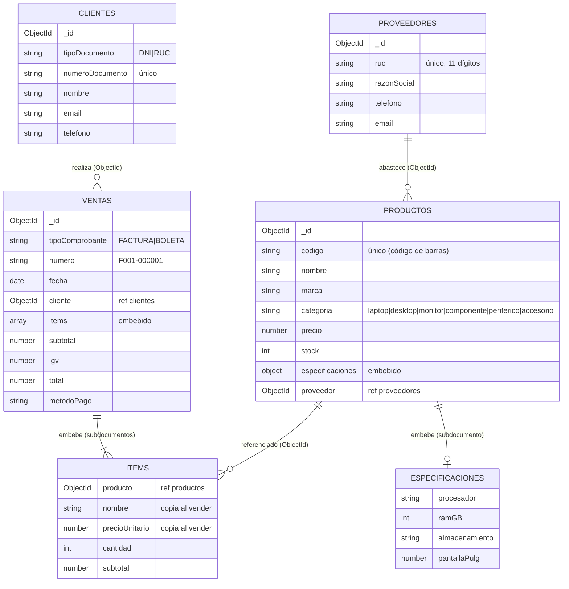

# Modelo de Documentos — Tienda de Computadoras

Base de datos: `tienda_computadoras`
Colecciones: `proveedores`, `productos`, `clientes`, `ventas`

## 1. Diagrama del modelo



## 2. Ejemplo de documento por colección

**productos**
```json
{
  "_id": { "$oid": "bbb000000000000000000001" },
  "codigo": "7501234500011",
  "nombre": "Laptop IdeaPad Slim 3 15\"",
  "marca": "Lenovo",
  "categoria": "laptop",
  "precio": 2599,
  "stock": 12,
  "especificaciones": {
    "procesador": "AMD Ryzen 5 7520U",
    "ramGB": 8,
    "almacenamiento": "512 GB SSD",
    "pantallaPulg": 15.6
  },
  "proveedor": { "$oid": "aaa000000000000000000001" }
}
```

**ventas** (factura)
```json
{
  "tipoComprobante": "FACTURA",
  "numero": "F001-000001",
  "fecha": { "$date": "2026-09-18T10:10:00Z" },
  "cliente": { "$oid": "ccc000000000000000000003" },
  "items": [
    { "producto": { "$oid": "bbb000000000000000000004" }, "nombre": "PC Gamer Ryzen 7 RTX 4060",
      "precioUnitario": 5499, "cantidad": 2, "subtotal": 10998 }
  ],
  "subtotal": 10689.83,
  "igv": 1924.17,
  "total": 12614,
  "metodoPago": "TRANSFERENCIA"
}
```

## 3. Justificación: embeber vs. referenciar

| Relación | Decisión | Motivo |
|---|---|---|
| Producto → especificaciones | **Embebido** | Siempre se leen con el producto, son pocas y varían según la categoría (un monitor no tiene procesador). El esquema flexible de MongoDB evita tablas vacías. |
| Producto → proveedor | **Referencia (`ObjectId`)** | Un proveedor abastece muchos productos; si cambia su teléfono se actualiza en un solo documento. |
| Venta → cliente | **Referencia (`ObjectId`)** | Un cliente tiene muchas compras (crece sin límite). El historial se obtiene con `ventas.find({cliente})` usando el índice `cliente + fecha`. Embeber las ventas en el cliente haría crecer el documento sin control (límite 16 MB). |
| Venta → ítems | **Embebido** | Los ítems pertenecen solo a esa factura, se crean y leen juntos y no se modifican después. Se lee la factura completa en una sola consulta. |
| Ítem → producto | **Referencia + copia de datos (snapshot)** | Se guarda el `ObjectId` para reportes con `$lookup`, y además se copia `nombre` y `precioUnitario`: una factura emitida no debe cambiar si mañana sube el precio del producto. |

## 4. Reglas de facturación aplicadas

- Cliente con **RUC** → `FACTURA` serie `F001`; cliente con **DNI** → `BOLETA` serie `B001`.
- Los precios incluyen IGV (18 %): `subtotal = total / 1.18`, `igv = total - subtotal`.
- El precio se toma de la base de datos, no del cuerpo de la petición.
- El stock se descuenta de forma atómica (`$inc` con condición `stock >= cantidad`); si un ítem falla, se revierte lo descontado.
